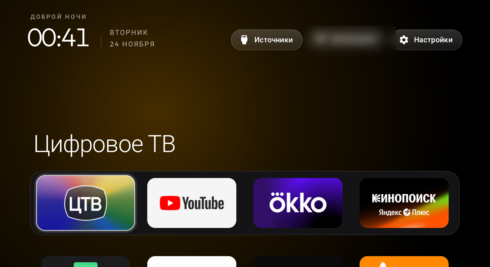
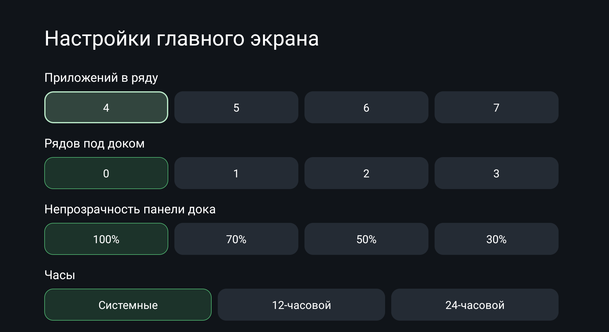
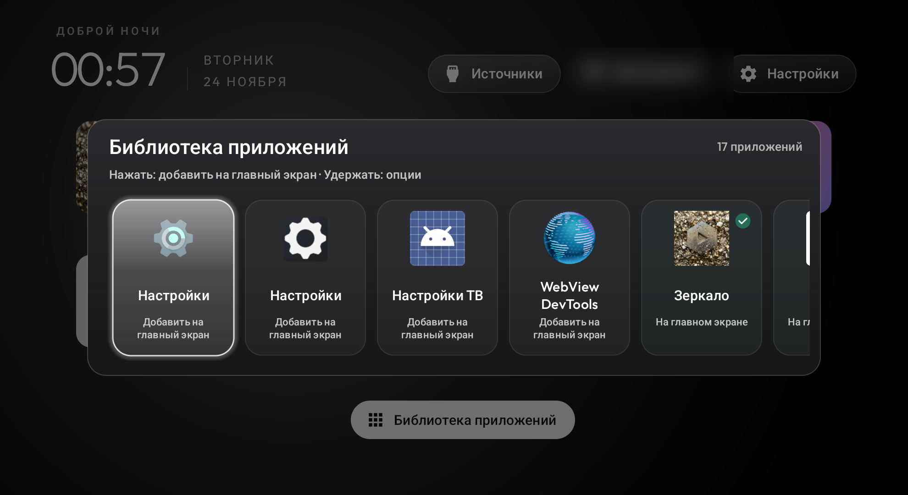
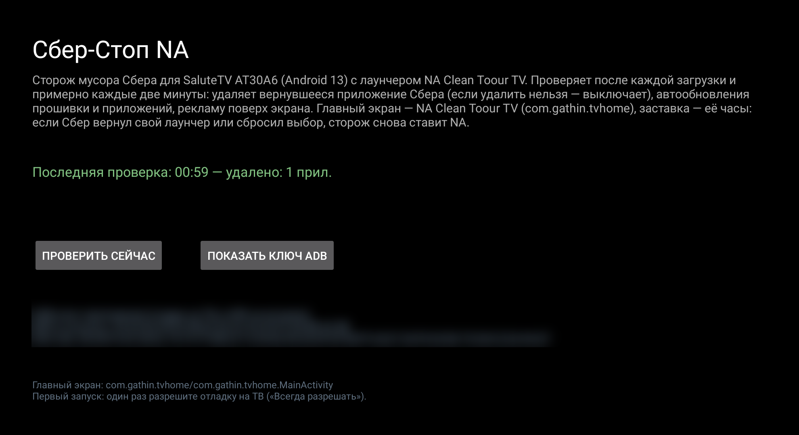
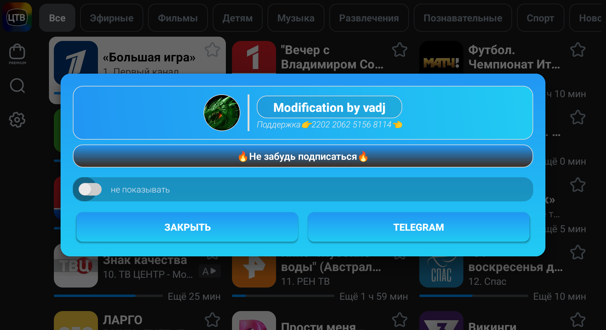

# SaluteTV (Сбер ТВ) AT30A6 — постоянный ADB без запросов, root, лаунчер NA Clean Toour TV

Полный набор для телевизора **SaluteTV AT30A6** (Amlogic T962D4 «t5w», Android 13 / StarOS):
ADB, который больше не спрашивает разрешение и сам поднимается после загрузки; root через уязвимый
вендорный сервис `cvte.at_sudo`; русский лаунчер **NA Clean Toour TV** вместо лаунчера Сбера;
замена «Эфир ТВ+» на «Цифровое ТВ»; удаление приложений Сбера и сторож, который возвращает порядок
после каждой перезагрузки.

> **EN (short):** Everything for the SaluteTV AT30A6 (Amlogic T962D4, Android 13, StarOS): persistent
> passwordless ADB (`adb_keys` + `persist.adb.tcp.port`) obtained with a root shell from the vendor's
> `cvte.at_sudo` service (its caller checks are spoofable), the NA Clean Toour TV launcher as Home,
> Sber launcher/junk removal with a watchdog, and a replacement for the preinstalled live-TV app.
> Nothing is flashed, no bootloader unlock, no factory reset.



## Телевизор

| Параметр | Значение |
|---|---|
| Бренд и модель | **SaluteTV (Сбер ТВ) AT30A6**, 50″ |
| `ro.product.brand` / `model` / `device` | `SaluteTV` / `SaluteTV` / `at30a6` |
| Плата / ODM | CVTE, `ro.cvte.model` = `MD_CVTE_OVERSEA_T962D4_13_0_D18D20_2GB_STARKOS`, `ro.cvte.customer` = `SBER` |
| Панель | `LE50VC3_CV500U5_T02_V02_WDX_MS` |
| SoC | **Amlogic T962D4 («t5w»)**, 4× Cortex-A55, **32-бит** (`armeabi-v7a`), 2 ГБ ОЗУ |
| ОС | **Android 13** (SDK 33), StarOS `1.103.80-b32095`, сборка `TP1A.220905.004.A2` (2026-06-17) |
| Экран (UI) | 1920×1080 (override 1980×1080), 320 dpi |
| Безопасность | SPL `2022-09-05`, загрузчик залочен (`verifiedbootstate=green`, `vbmeta.device_state=locked`), dm-verity выключена (`veritymode=disabled`), **SELinux = permissive** |
| ADB | adbd на `5555`, `ro.adb.secure=1`, `ro.debuggable=0` |
| Раздел /data | 3,0 ГБ; без чистки свободно было ~0,3 ГБ |

Подробный дамп свойств и пакетов — [docs/device-info.md](docs/device-info.md).

## Что сделано

1. **Постоянный ADB без диалога.** Галочка «Всегда разрешать» на этой прошивке не сохраняется
   (`/data/misc/adb/adb_keys` не создавался), порт 5555 после загрузки не поднимался. Через root
   ключи прописаны в `adb_keys`, включены `persist.adb.tcp.port=5555` и `persist.vendor.staros.adb=1`.
   Проверено двумя перезагрузками ТВ и перезапуском adb-сервера на компьютере — `adb connect` сразу
   даёт `device`, диалога нет.
2. **Root без прошивки.** Вендорный сервис `cvte.at_sudo` (`/vendor/bin/at_sudo`, работает от root)
   выполняет команду, если вызывающий uid = 0/1000/2000 и `/proc/<pid>/cmdline` начинается с
   `com.cvte.factory.service` или `com.cvte.tv.api.impl`. Имя процесса подделывается из shell —
   получаем `uid=0(root)`. Разделы не трогаются, загрузчик не разлочивается.
3. **Лаунчер NA Clean Toour TV** (`com.gathin.tvhome`) из
   [kryzhukov/natx5cleanyourtv](https://github.com/kryzhukov/natx5cleanyourtv) — главный экран,
   конфиг с доком (Цифровое ТВ, YouTube, Okko, Кинопоиск), заставка — часы лаунчера.
4. **Лаунчер Сбера удалён**, вместе с ним 19 приложений Сбера (`pm uninstall --user 0`). Оставлены
   нужные для пульта, ассистента, «Телеканалов» и настроек.
5. **«Эфир ТВ+» заменён на «Цифровое ТВ»** (Lime HD, `limehd.ru.ctv` 5.1.1); старый APK сохранён.
6. **Автообновления Сбера выключены**: `ota_disable_automatic_update=1`, `auto_update_apps=0`
   и отключён сам OTA-апдейтер (`ru.sberdevices.updater`, `enabled=disabled-user`). Проверено
   перезагрузкой — не включается обратно.
7. **Сторож «Сбер-Стоп NA»** (`io.sberstop`) — после загрузки и раз в ~2 минуты удаляет вернувшееся,
   возвращает Home на NA, выключает автообновления и рекламный оверлей Сбера. Его ADB-ключ
   сгенерирован заранее и внесён в `adb_keys` — подключается без диалога. **Работает в фоне**
   (JobScheduler, `PERSISTED`): экран не открывает и поверх лаунчера не появляется — UI только
   если запустить вручную кнопкой «Проверить сейчас».
   Версия **2.3-NA** дополнительно чистит **кеш и данные «Цифрового ТВ»** (`limehd.ru.ctv`) после
   каждого закрытия/выключения экрана (служба доступности и/или фоновый `CleanerService`;
   `pm clear` сбрасывает вход в ЦТВ — отключается флажком в приложении, см.
   [docs/apps.md](docs/apps.md#очистка-кеша-и-данных-цифрового-тв-после-закрытия)).
   Универсальный режим: на ТВ **без Сбера** (YAOS/Hartens и др.) Sber-логика пропускается,
   работает только очистка ЦТВ; для них есть отдельный скрипт
   [scripts/install-ctv-cleaner.sh](scripts/install-ctv-cleaner.sh).

## Состав репозитория

| Путь | Что это |
|---|---|
| [scripts/install-root-tool.sh](scripts/install-root-tool.sh) | положить на ТВ инструмент root (`atsudo.dex`) |
| [scripts/root.sh](scripts/root.sh) | `./root.sh '<команда>'` — выполнить команду от root |
| [scripts/install-adb-keys.sh](scripts/install-adb-keys.sh) | прописать доверенные ADB-ключи и постоянный TCP ADB |
| [scripts/debloat.sh](scripts/debloat.sh) + [debloat.txt](scripts/debloat.txt) | удалить приложения Сбера (список с комментариями) |
| [scripts/install-launcher.sh](scripts/install-launcher.sh) | установить NA Clean Toour TV, сделать Home, заставку, конфиг |
| [scripts/install-watchdog.sh](scripts/install-watchdog.sh) | установить сторожа и его ADB-ключ (без запроса) |
| [scripts/install-ctv-cleaner.sh](scripts/install-ctv-cleaner.sh) | поставить ЦТВ + очистку на ТВ без Сбера (YAOS/Hartens и др.) |
| [scripts/block-ota.sh](scripts/block-ota.sh) | выключить автообновления прошивки/приложений и OTA-апдейтер |
| [scripts/verify.sh](scripts/verify.sh) | проверить итоговое состояние ТВ |
| [apk/](apk) | готовые `NA-Clean-Toour-TV-3.5.apk` и `SberStop-NA-2.3.apk` |
| [watchdog/](watchdog) | исходники сторожа «Сбер-Стоп NA» 2.3-NA (Java, сборка без Gradle) |
| [docs/atsudo-root.md](docs/atsudo-root.md) | как устроен root через `cvte.at_sudo` (разбор бинаря, протокол, сборка) |
| [docs/adb-permanent.md](docs/adb-permanent.md) | как сделан постоянный ADB и как добавить ключ другого ПК |
| [docs/apps.md](docs/apps.md) | лаунчер, замена «Эфир ТВ+», чистка, сторож |
| [docs/restore.md](docs/restore.md) | полный откат к стоковому состоянию |
| [screenshots/](screenshots) | главный экран, сторож, «Цифровое ТВ» |

## Скриншоты

| Главный экран | Настройки главного экрана | Библиотека приложений |
|---|---|---|
|  |  |  |

| Сторож «Сбер-Стоп NA» | «Цифровое ТВ» вместо «Эфир ТВ+» |
|---|---|
|  |  |

## Быстрый старт

Нужны: компьютер и ТВ в одной сети, `adb` (platform-tools), на ТВ включена отладка по сети
(на AT30A6 — через заводское меню CVTE, см. [docs/device-info.md](docs/device-info.md#как-включить-adb)).

```bash
export TV_SERIAL=192.168.1.50:5555       # IP вашего ТВ
adb connect "$TV_SERIAL"                  # первый раз: подтвердить «Всегда разрешать»

bash scripts/install-root-tool.sh         # atsudo.dex → /data/local/tmp/
bash scripts/root.sh 'id'                 # ожидаем uid=0(root) context=u:r:su:s0

bash scripts/install-adb-keys.sh          # ключ этого ПК в adb_keys + persist.adb.tcp.port
adb reboot
adb connect "$TV_SERIAL"                  # проверка: подключение БЕЗ запроса

bash scripts/install-launcher.sh          # NA Clean Toour TV → Home
bash scripts/block-ota.sh                 # (по желанию) жёстко выключить автообновления Сбера
bash scripts/debloat.sh                   # убрать приложения Сбера
bash scripts/install-watchdog.sh          # сторож (после перезагрузки — сам)
adb reboot
bash scripts/verify.sh                    # итоговая проверка
```

Замена «Эфир ТВ+» на «Цифровое ТВ» — вручную, по шагам из [docs/apps.md](docs/apps.md#замена-эфир-тв-на-цифровое-тв):
APK сторонний, в репозиторий не входит.

## Как это устроено

* [docs/atsudo-root.md](docs/atsudo-root.md) — разбор `/vendor/bin/at_sudo`: проверки uid и
  `/proc/<pid>/cmdline`, метод `system()`, сборка клиента (`app_process` + `Process.setArgV0`).
* [docs/adb-permanent.md](docs/adb-permanent.md) — почему «Всегда разрешать» не работало,
  формат `/data/misc/adb/adb_keys`, `persist.adb.tcp.port`, проверки и ограничения.
* [docs/apps.md](docs/apps.md) — лаунчер и его конфиг, список удалённого/оставленного, сторож.

## Проверено

| Проверка | Результат |
|---|---|
| `adb connect` после 2 перезагрузок ТВ и перезапуска adb-сервера | `device`, без запроса |
| `persist.adb.tcp.port` / `service.adb.tcp.port` | `5555` / `5555` |
| Главный экран | `com.gathin.tvhome/.MainActivity` |
| `ru.sberdevices.starlauncher` и 19 приложений Сбера | отсутствуют |
| «Цифровое ТВ» (`limehd.ru.ctv` 5.1.1) | установлен, запускается |
| Сторож после перезагрузки | поднялся сам, вернувшееся приложение удалил, Home вернул NA |
| Очистка ЦТВ после закрытия (Сбер-ТВ) | работает: Home/другое приложение/выключение экрана → `pm clear`; данные 8,7 МБ/102 файла → 4 КБ/0 файлов |
| Очистка ЦТВ на Hartens (YAOS, без Сбера) | работает через `CleanerService`: 16:05:47 ЦТВ на экране → 16:05:50 «pm clear limehd.ru.ctv: Success»; штатный Home/заставка не тронуты; после перезагрузки сервис поднялся сам |
| Заставка | `com.gathin.tvhome/.ClockDream` |

## Важно

* **ADB-ключ компьютера теперь доверенный навсегда** (`~/.android/adbkey`) — это полный доступ
  к ТВ. Берегите файл; убрать ключ можно через root (`docs/adb-permanent.md#откат`).
* Для **нового, незнакомого** ключа (другой ПК) прошивка всё равно покажет запрос: `ro.adb.secure=1`
  снимается только правкой прошивки. Добавить ещё один ПК — `scripts/install-adb-keys.sh <его key.pub>`.
* **Прошивка Сбера возвращает свой лаунчер/часть приложений** после перезагрузки — их удаляет сторож
  (в течение ~2 минут). Если сторожа выключить, мусор вернётся.
* **Сброс к заводским настройкам** возвращает всё стоковое: и launcher, и запросы ADB (ключи пропадут).
* **StarOS «ротация»**: при нехватке места в /data система может удалять sideload-приложения —
  следите за свободным местом (после чистки его ~0,6–0,9 ГБ).
* Root-метод не трогает разделы и не переживает сброс; после сброса повторите шаги из «Быстрого старта».

## Безопасность и приватность

* **Приватных ключей в репозитории нет.** `adb_keys` на ТВ формируется скриптом из **вашего**
  `~/.android/adbkey.pub`; ключ сторожа генерируется локально при установке (`scripts/wd-key/`
  в `.gitignore`) и в APK не встроен — в APK вообще нет ключей и путей сборки.
* В примерах используется **вымышленный** IP `192.168.1.50`; скрипты требуют явный `TV_SERIAL`.
* На скриншотах **размыты SSID Wi-Fi и отпечатки ADB-ключа**. Если добавляете свои скриншоты —
  размывайте сеть, серийные номера и ключи.
* `docs/device-info.md` описывает только модель/прошивку (как и в других репозиториях по этим ТВ),
  без серийного номера и MAC.

## Лицензия

Наши скрипты и документация — **MIT**, см. [LICENSE](LICENSE).
Лаунчер **NA Clean Toour TV** — [kryzhukov/natx5cleanyourtv](https://github.com/kryzhukov/natx5cleanyourtv)
(на базе [cleanyourtv](https://github.com/kryzhukov/natx5cleanyourtv)); «Сбер-Стоп NA» — производная от
[sber-tv-at30a6-free-my-tv](https://github.com/kryzhukov/sber-tv-at30a6-free-my-tv). Сторонние
приложения (Цифровое ТВ, YouTube, Okko, Кинопоиск) в репозиторий не входят. Проект не связан со
Сбером, CVTE, Amlogic и Google; все торговые марки принадлежат владельцам.
