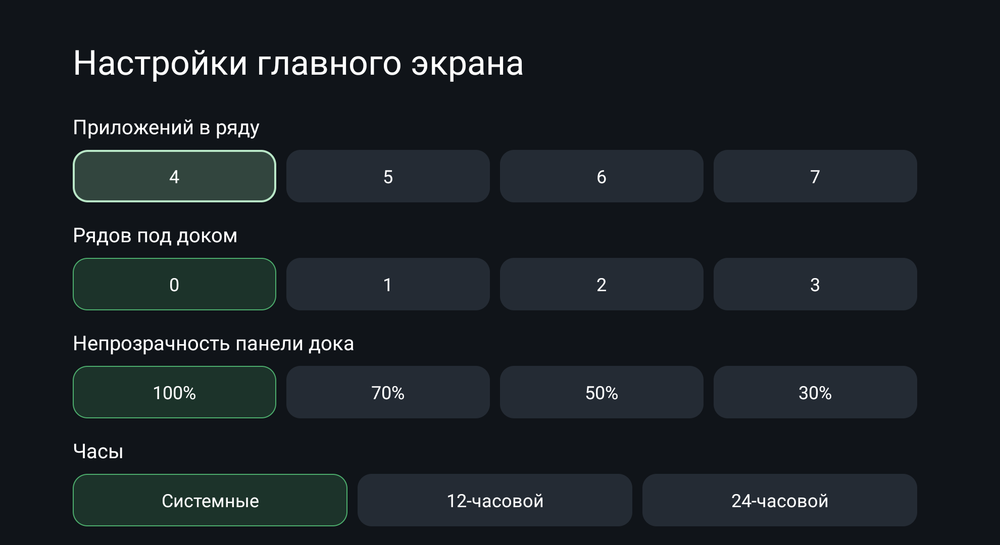
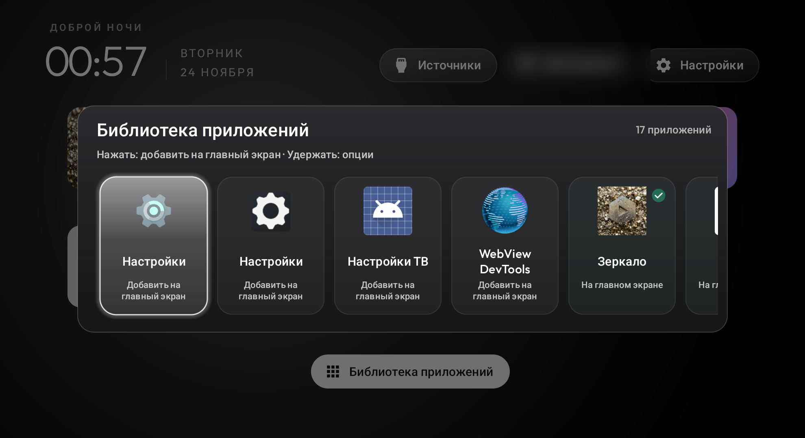

# Лаунчер, «Цифровое ТВ», чистка и сторож

## Лаунчер NA Clean Toour TV

Исходники — [kryzhukov/natx5cleanyourtv](https://github.com/kryzhukov/natx5cleanyourtv) (русская
сборка NA TV Лаунчер, `com.gathin.tvhome`, `minSdk` 26). В репозитории лежит уже собранный APK:
[`apk/NA-Clean-Toour-TV-3.5.apk`](../apk/NA-Clean-Toour-TV-3.5.apk)
(sha256 `e170ce4fcc6026b7b7fff52207d49d6256656c4ae3d5ca6baa870581ae83f34e`).

Установка и назначение главным экраном — [`scripts/install-launcher.sh`](../scripts/install-launcher.sh):

```bash
scripts/install-launcher.sh
```

Скрипт: ставит APK → запускает и **проверяет, что активити поднялась** → `cmd package
set-home-activity --user 0 com.gathin.tvhome/.MainActivity` → проверяет, что Home действительно
переключился → кладёт конфиг и ставит заставку. **Лаунчер Сбера удаляется отдельно и только
после этого** — иначе можно остаться без главного экрана.

### Как это выглядит

| Главный экран | Настройки главного экрана | Библиотека приложений |
|---|---|---|
|  |  |  |

### Конфиг без пересборки

Лаунчер читает `config.json` из своего external-каталога и накладывает его поверх встроенного
`config.xml`:

```
/sdcard/Android/data/com.gathin.tvhome/files/config.json
```

Файл [`scripts/launcher-config.json`](../scripts/launcher-config.json):

* `dock_apps` — **Цифровое ТВ, YouTube, Okko, Кинопоиск** (первым — новый ТВ-клиент);
* `hidden_apps` — заводские меню CVTE, настройки ТВ, webview, остатки Сбера — не показывать в сетке;
* `app_labels` — «Центр управления», «Телеканалы», «СберTube» вместо невнятных имён Сбера.

Заставка: `settings put secure screensaver_components com.gathin.tvhome/.ClockDream`.
Автообновления прошивки/приложений выключаются: `ota_disable_automatic_update=1`, `auto_update_apps=0`.

### Автообновления прошивки и приложений

Скрипт [`scripts/block-ota.sh`](../scripts/block-ota.sh):

* `settings put global ota_disable_automatic_update 1` — без автообновления прошивки;
* `settings put global auto_update_apps 0` — без автообновления приложений;
* `pm disable-user --user 0 ru.sberdevices.updater` — сам OTA-апдейтер Сбера
  (`/system/priv-app/SberDevicesUpdater`) отключён (`enabled=disabled-user`).

Проверено перезагрузкой: настройки и отключённый апдейтер сохраняются, ТВ загружается нормально,
пульт/ассистент/«Телеканалы» работают. `ru.sberdevices.rcfupdater` (прошивка **пульта**) и
`ru.sberdevices.services.core` не трогаются. Вернуть обновления — команды в шапке скрипта.

### Сборка из исходников (если нужен свой APK)

```bash
git clone https://github.com/kryzhukov/natx5cleanyourtv
cd natx5cleanyourtv/launcher
export JAVA_HOME=/path/to/jdk-17
export ANDROID_HOME=/path/to/android-sdk    # build-tools;34.0.0, platforms;android-34
echo "sdk.dir=$ANDROID_HOME" > local.properties
./gradlew assembleRelease
# app/build/outputs/apk/release/app-release.apk
```

## Замена «Эфир ТВ+» на «Цифровое ТВ»

На стоковом ТВ стоит **«Эфир ТВ+»** — `limehd.ru.ctvshka` 4.4.0 (приложение Lime HD). Его место
занимает **«Цифровое ТВ»** — `limehd.ru.ctv` 5.1.1 (тоже Lime HD, с телеканалами).

APK «Цифрового ТВ» — **сторонний**, в репозиторий не входит: возьмите свой файл (у автора это
`Цифровое-ТВ-5.1.1.apk`, sha256 `9569a6c6c354b96203aa1234643db7baaae29516f08de60c19427a7e24e44eaa`).

```bash
# 1) бэкап старого приложения (чтобы можно было вернуть)
adb -s "$TV_SERIAL" shell pm path limehd.ru.ctvshka      # → /data/app/.../base.apk
adb -s "$TV_SERIAL" pull /data/app/.../base.apk backup/limehd.ru.ctvshka-4.4.0.apk

# 2) удалить «Эфир ТВ+»
adb -s "$TV_SERIAL" shell pm uninstall --user 0 limehd.ru.ctvshka

# 3) установить «Цифровое ТВ»
adb -s "$TV_SERIAL" install -r Цифровое-ТВ-5.1.1.apk
```

Проверка: `am start -W -n limehd.ru.ctv/limehd.ru.ctv.MainActivity` → `Status: ok`, видны каналы.
Сборка, которая проверялась, — «Modification by vadj»: при первом запуске показывает окно
поддержки с галочкой «не показывать».

Откат: `adb install -r backup/limehd.ru.ctvshka-4.4.0.apk && adb shell pm uninstall --user 0 limehd.ru.ctv`.

## Чистка приложений Сбера

Список — [`scripts/debloat.txt`](../scripts/debloat.txt) (19 пакетов Сбера + Projectivy),
удаление — [`scripts/debloat.sh`](../scripts/debloat.sh):

```bash
scripts/debloat.sh --dry-run   # посмотреть
scripts/debloat.sh             # удалить (pm uninstall --user 0)
```

Удаляется «для пользователя 0»: иконка и данные пропадают, APK остаётся в прошивке, вернуть можно
`cmd package install-existing --user 0 <pkg>`. После чистки освободилось ~600 МБ (было 284 МБ
свободных на 3,0 ГБ).

**Оставлено специально** (иначе отваливаются пульт/ассистент/каналы/настройки):
`ru.sberdevices.services(.core)`, `ru.sberdevices.assistant`, `ru.sberdevices.tvinputs`,
`ru.sberdevices.starlivetv` («Телеканалы»), `ru.sberdevices.startube`, `ru.sberdevices.rcfupdater`,
`ru.sberdevices.gamepad.service`, `ru.sberdevices.app.starkeyboard`, `ru.sberdevices.webview`,
`ru.sberdevices.settings`, `com.sberbank.settings`, все `com.cvte.*` и `com.droidlogic.*`.

## Сторож «Сбер-Стоп NA»

Прошивка Сбера при каждой загрузке возвращает свой лаунчер и часть приложений. Сторож
(`io.sberstop`, 2.3-NA, [`apk/SberStop-NA-2.3.apk`](../apk/SberStop-NA-2.3.apk), sha256
`b378b147207a85eba298d4ad966d3a3bf0c33c4c00649eaedee019d8bca5e751`; исходники —
[`watchdog/`](../watchdog)) собран из проекта
[sber-tv-at30a6-free-my-tv](https://github.com/kryzhukov/sber-tv-at30a6-free-my-tv) и переделан
под лаунчер NA:

* после `BOOT_COMPLETED` (через ~45 с) и далее каждые ~2 минуты (JobScheduler, `persisted`);
* удаляет вернувшиеся пакеты из списка (если удалить не дают — `disable-user`);
* возвращает Home на `com.gathin.tvhome` и заставку `ClockDream`, если Сбер их сбросил;
* выключает автообновления и рекламный оверлей (`appops SYSTEM_ALERT_WINDOW deny`).

Скрипт установки добавляет сторожа в whitelist Doze (`cmd deviceidle whitelist +io.sberstop`):
иначе JobScheduler откладывает проверки, пока телевизор «спит», и вернувшиеся приложения Сбера
живут дольше обычного.

Сторож ходит по ADB на `127.0.0.1:5555`. Чтобы он не вызывал запрос «Разрешить отладку»,
[`scripts/install-watchdog.sh`](../scripts/install-watchdog.sh) **заранее** генерирует его ключ,
кладёт приватную часть в `/data/data/io.sberstop/files/` и дописывает публичную в
`/data/misc/adb/adb_keys` (см. [adb-permanent.md](adb-permanent.md)). После установки — одна
перезагрузка, затем один запуск приложения и кнопка «Проверить сейчас».

Проверено: после перезагрузки сторож поднялся сам и отработал — «удалено: 1 прил., главный экран → NA».

### Очистка кеша и данных «Цифрового ТВ» после закрытия

В версии **2.1-NA** добавлена служба доступности `io.sberstop/io.sberstop.CtvCloseWatcher`:
после того как «Цифровое ТВ» (`limehd.ru.ctv`) уходит с переднего плана, сторож выполняет
`pm clear limehd.ru.ctv` — это очищает **и кеш, и данные** приложения.

* Детект: event от `limehd.ru.ctv` → «курок»; уход на другой экран → через 1.5 с проверка
  `mResumedActivity` через ADB (оверлеи/диалоги/шторка закрытием не считаются) → очистка.
  Отдельно — `ACTION_SCREEN_OFF`: выключение экрана при открытом ЦТВ тоже очищает.
* Антидребезг 3 с; если dumpsys не ответил — не чистит (безопаснее).
* Переключатель в приложении: «Чистить «Цифровое ТВ» после закрытия» (по умолчанию **включён**),
  строка статуса «Очистка ЦТВ: включена, последняя: чч:мм».

> ⚠️ `pm clear` сбрасывает **вход и настройки** приложения: после каждого закрытия ЦТВ придётся
> заново авторизоваться. Если это не нужно — снимите галочку в «Сбер-Стоп NA»; остальной сторож
> продолжит работать.

Скрипт [`scripts/install-watchdog.sh`](../scripts/install-watchdog.sh) при установке сам включает
службу доступности:

```bash
settings put secure enabled_accessibility_services io.sberstop/io.sberstop.CtvCloseWatcher
settings put secure accessibility_enabled 1
```

Проверка (adb, root не нужен):

```bash
adb logcat -d | grep CtvCloseWatcher        # "уход с экрана — pm clear limehd.ru.ctv: Success"
adb shell dumpsys accessibility | grep CtvCloseWatcher
```

### ТВ без Сбера / где служба доступности запрещена (2.3-NA, CleanerService)

На YAOS/Hartens сторонние службы доступности прошивка не включает, а `BOOT_COMPLETED` приложению
может не приходить, пока оно не в «белом списке» энергосбережения. Поэтому в 2.3-NA есть
`CleanerService` — foreground-сервис без интерфейса: раз в 2 с через ADB (`mResumedActivity`)
смотрит, не закрылось ли ЦТВ, и делает `pm clear limehd.ru.ctv` (антидребезг 3 с, `SCREEN_OFF` —
очистка). Sber-логика на таком ТВ пропускается guard'ом («не Сбер-ТВ»). Запрос «Разрешить
отладку» не появляется: сторож берёт **ADB-ключ этого ПК** из своего external-каталога
(`/sdcard/Android/data/io.sberstop/files/adbkey` + `adbkey.pub` в DER), а этот ключ уже доверен.

Установка одной командой (ставит ЦТВ + сторожа, подкладывает ключ, whitelist Doze, запускает сервис):

```bash
TV_SERIAL=192.168.1.113:5555 scripts/install-ctv-cleaner.sh /path/to/Цифровое-ТВ.apk
```

Проверено на Hartens HTY-50U11S-VD (Android 14/YAOS): открыл ЦТВ → Home → через ~3 с
`CleanerService: ЦТВ ушло с экрана … pm clear limehd.ru.ctv: Success`; штатный Home Яндекса и
заставка не тронуты; после перезагрузки сервис поднялся сам (BootReceiver + `deviceidle whitelist`).
Остановить очистку: снять флажок в приложении или `am stopservice -n io.sberstop/.CleanerService`.

### Он не будет висеть на экране

Обычные проходы идут через `JobScheduler` (`io.sberstop/.KeeperJob`, `PERSISTED`, каждые ~2 минуты):
это **фоновая служба без UI** — экран не открывается, поверх лаунчера ничего не появляется.
Проверено: после прохода в фоне на экране остаётся `com.gathin.tvhome/.MainActivity`, а время
последней проверки в `SharedPreferences` обновляется.

Видимое окно сторожа появляется только если **сами** его откроете (иконка в библиотеке приложений);
кнопка «Проверить сейчас» дополнительно показывает уведомление переднего плана. Если случайно
открыли — нажмите **Home**: проверки продолжат идти в фоне. Не делайте «Остановить»/force-stop —
это переводит приложение в stopped-состояние и задания не будут запускаться до следующего запуска.

## Итоговые проверки

| Проверка | Результат |
|---|---|
| Главный экран | `com.gathin.tvhome/.MainActivity` |
| Заставка | `com.gathin.tvhome/.ClockDream` |
| Лаунчер Сбера и 19 приложений | отсутствуют |
| «Цифровое ТВ» 5.1.1 | установлен, запускается |
| Сторож после перезагрузки | поднялся сам, вернул Home, удалил вернувшееся |
| Очистка ЦТВ после закрытия | Home/другое приложение и выключение экрана → `pm clear`, данные 8,7 МБ/102 файла → 4 КБ/0 |
| Свободно на /data | ~0,6–0,9 ГБ |
